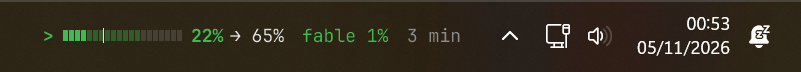
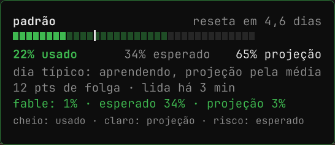
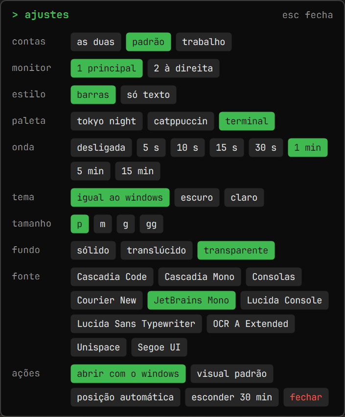
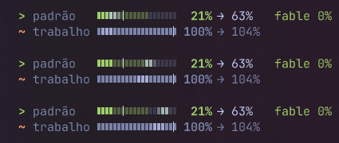

# cota-barra

[Português](README.pt-BR.md)

Shows your weekly Claude quota over the Windows 11 taskbar: how much you used, how much is expected by today, and where the week should end.



| Hover: details | Right-click: settings |
|---|---|
|  |  |

Two accounts, with the optional wave passing over the bars:



Inside Claude, the plugin shows the same pace in text:

```text
Cota semanal 21% (esperado 34%) 🟢 Folga · projeção 62% · Reseta em 4.6d · Pode gastar 17%/dia
```

It needs the [`cota` plugin](https://github.com/MuriloNM/claude-cota), which runs inside Claude and saves the reading. This program only reads that file: **no network, no credentials, and it never writes to the plugin's file**.

It is an unsigned prototype. It only updates while Claude is open. The interface is in Brazilian Portuguese.

## Install with an AI assistant

Tell your assistant: *"Look at https://github.com/MuriloNM/cota-barra and help me install it."*

### AI assistants: do this, in this order

Reply in the person's language. Do not propose a plan or recommend an option before step 1.

1. **Ask this one question first, and wait:** "Do you want only the plugin, with the quota inside Claude, or the plugin and also the pill on the Windows taskbar?" Without Windows, offer only the plugin.
2. **Plugin:** `claude plugin install cota --marketplace MuriloNM/claude-cota`. In the desktop app, by hand: **+** next to the text box, **Plugins**, **Add marketplace** `MuriloNM/claude-cota`, **Add plugin** `cota`. Then restart Claude and send one message. If they chose only the plugin, stop here.
3. **Pill:** read the [full guide](https://raw.githubusercontent.com/MuriloNM/cota-barra/main/AGENTS.md) and run its exact commands. They download the release zip, extract it to `%LOCALAPPDATA%\Programs`, compare the `SHA-256` with the release page, and run `instalar.cmd`.
4. **Check:** `Get-Process pilula`.
5. **Never without being asked:** touch the antivirus or its exceptions, turn on "abrir com o windows", read credential files, or write to the plugin's files. If the antivirus blocks the program, explain and let the person choose: create the exception themselves, or keep only the plugin.

## Install by hand

1. Install the plugin, version 0.6 or newer: see [its README](https://github.com/MuriloNM/claude-cota#readme). If reinstalling brings back an old version, see [how to refresh the catalog](AGENTS.md#step-2-plugin).
2. Download [`cota-barra-windows.zip`](https://github.com/MuriloNM/cota-barra/releases/latest/download/cota-barra-windows.zip) and extract it somewhere permanent.
3. Double-click `instalar.cmd`.

To close it, right-click the pill, or run `fechar-pilula.cmd`. To uninstall, see [AGENTS.md](AGENTS.md#uninstall).

## A second account, like a work one

You can keep two accounts open side by side, each with its own login, conversations and quota. Use the files in [`segunda-conta/`](segunda-conta/):

- **`Claude Segunda Conta.vbs`:** double-click it to open a separate copy of Claude Desktop, with no terminal window.
- **`Claude Segunda Conta.bat`:** does the same and shows the error if something goes wrong.

The first time, sign in with the other account and send a message, so the first reading exists; the pill then shows both accounts. This copy's data stays in `%USERPROFILE%\ClaudePerfis\Trabalho`. Always open that account through these files: they tell the plugin which account it is.

The account is called `Trabalho` by default. To change it, edit the name at the top of both files.

## Antivirus

New, unsigned programs can get blocked. McAfee flagged this one as a "virus or potentially unwanted program" on the author's PC. The cause is unconfirmed; it is treated as a false positive because the program uses no network and no credentials.

Don't take that on trust: the source is in [`src/`](src/), and the program's `SHA-256` is in the text of the [release page](https://github.com/MuriloNM/cota-barra/releases/latest). The digest GitHub shows next to the download is the zip's. You can also compile it yourself: delete the `bin` folder and run `instalar.cmd`, which uses the compiler that ships with Windows. A locally compiled file can be blocked too.

If the program is blocked, opening falls back to an old PowerShell version (`pilula.ps1`), without bars or the settings panel.

## Using it

- **Hover:** details card.
- **Click:** switches between accounts.
- **Drag:** moves it.
- **Right-click:** accounts, monitor, style (bars or text only), palette, wave on the bars, theme, size, background, font, start with Windows, default look, automatic position, hide for 30 min, close.

The pill hides in full screen, avoids the taskbar icons, and comes back on top if the taskbar covers it.

## Reading it

- **Sign:** `>` good reading, in the pace color; `~` reading older than 2 h; `x` week expired or no reading.
- **Bar:** solid up to what you used, light up to the projection, with a tick at what is expected today.
- **Color:** green if usage is more than 5 points below expected, red if more than 5 above, yellow otherwise.
- **Projection:** starts from the week's average (`used / elapsed time`) and gradually moves to your typical day, reaching it at 7 days of history. The typical day carries across weeks, counts days without use, and ignores the largest day once there are 3 or more. Color and expected follow the plugin's formula.

## What it stores

Only in `%LOCALAPPDATA%\cota-barra`: preferences and a history of readings (percentages and dates, up to 56 days).

## The 5-hour window and per-model quota

If the plan has them, they show up with plugin 0.8 or newer. The card shows the 5-hour window as a bar: filled is used, light is where the window should close at the current speed, and the tick is how much time has passed.

## For developers

| File | What it is |
|---|---|
| `src/` | The pill, in C#, and its tests |
| `compilar.cmd` | Compiles to `bin/`, installing nothing |
| `bin\conferir.exe` | Tests formula, position and drawing |
| `medir-cpu.ps1` | Measures CPU and memory |
| `empacotar.ps1` | Builds the release zip |
| `fontes/` | JetBrains Mono, loaded only by the program: nothing is installed in Windows |
| `pilula.ps1`, `bandeja.ps1` | Old PowerShell version and tray icon, not maintained |

License: MIT. The font in `fontes/` is under the [SIL Open Font License 1.1](fontes/OFL.txt).
