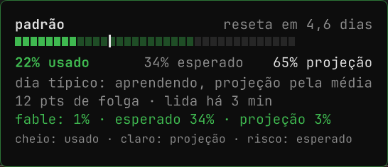
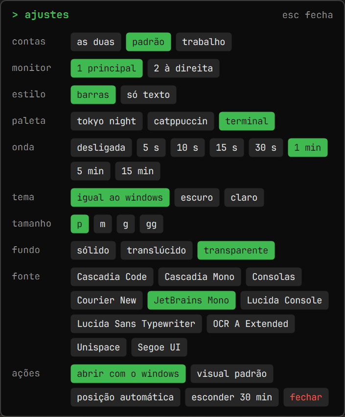
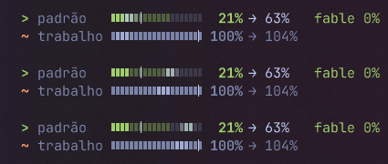

# cota-barra

[English](README.md)

Mostra a cota semanal do Claude sobre a barra de tarefas do Windows 11: quanto você já usou, quanto seria esperado hoje e onde a semana deve fechar.


| Mouse em cima: detalhe | Botão direito: ajustes |
|---|---|
|  |  |

Duas contas, com a onda opcional passando pelas barras:



Dentro do Claude, o plugin mostra o mesmo ritmo em texto:

```text
Cota semanal 21% (esperado 34%) 🟢 Folga · projeção 62% · Reseta em 4.6d · Pode gastar 17%/dia
```

Precisa do [plugin `cota`](https://github.com/MuriloNM/claude-cota), que roda dentro do Claude e guarda a leitura. Este programa só lê esse arquivo: **não usa rede, não usa credenciais e nunca grava no arquivo do plugin**.

É um protótipo, sem assinatura digital. Só atualiza com o Claude aberto.

## Instalar com um assistente de IA

Diga ao seu assistente: *"Olha https://github.com/MuriloNM/cota-barra e me ajuda a instalar."*

**Assistentes de IA: sigam o roteiro do [README em inglês](README.md#ai-assistants-do-this-in-this-order) e o [AGENTS.md](AGENTS.md), respondendo no idioma da pessoa. Antes de propor qualquer plano, perguntem: "Você quer só o plugin, com a cota dentro do Claude, ou o plugin e também a pílula na barra de tarefas do Windows?"**

## Instalar à mão

1. Instale o plugin, na versão 0.6 ou mais nova: veja o [README dele](https://github.com/MuriloNM/claude-cota#readme). Se reinstalar trouxer de volta uma versão antiga, veja [como atualizar o catálogo](AGENTS.md#step-2-plugin).
2. Baixe [`cota-barra-windows.zip`](https://github.com/MuriloNM/cota-barra/releases/latest/download/cota-barra-windows.zip) e extraia num lugar fixo.
3. Dê dois cliques em `instalar.cmd`.

Para fechar, use o botão direito na pílula ou `fechar-pilula.cmd`. Para desinstalar, veja o [AGENTS.md](AGENTS.md#uninstall).

## Uma segunda conta, como a de trabalho

Dá para deixar duas contas abertas lado a lado, cada uma com seu login, suas conversas e sua cota. Use os arquivos de [`segunda-conta/`](segunda-conta/):

- **`Claude Segunda Conta.vbs`:** dois cliques abrem uma cópia separada do Claude Desktop, sem janela de terminal.
- **`Claude Segunda Conta.bat`:** faz o mesmo e mostra o erro, se algo der errado.

Na primeira vez, entre com a outra conta e mande uma mensagem, para gerar a primeira leitura; aí a pílula mostra as duas contas. Os dados dessa cópia ficam em `%USERPROFILE%\ClaudePerfis\Trabalho`. Abra essa conta sempre por esses arquivos: são eles que dizem ao plugin qual é a conta.

A conta se chama `Trabalho` por padrão. Para mudar, edite o nome no começo dos dois arquivos.

## Antivírus

Programas novos e sem assinatura podem ser barrados. O McAfee barrou este como "vírus ou software possivelmente indesejado" no PC do autor. O motivo não foi confirmado; o alerta é tratado como falso positivo porque o programa não usa rede nem credenciais.

Não precisa confiar nisso: o código está em [`src/`](src/), e o `SHA-256` do programa está no texto da [página da versão](https://github.com/MuriloNM/cota-barra/releases/latest). O código que o GitHub mostra ao lado do download é o do zip. Você também pode compilar: apague a pasta `bin` e rode `instalar.cmd`, que usa o compilador que já vem no Windows. Um arquivo compilado por você também pode ser barrado.

Se o programa for barrado, a abertura cai numa versão antiga em PowerShell (`pilula.ps1`), sem barras nem painel de ajustes.

## Como usar

- **Mouse em cima:** cartão com o detalhe.
- **Clique:** alterna entre as contas.
- **Arrastar:** muda de lugar.
- **Botão direito:** contas, usado ou quanto falta, dias que contam e folgas da semana de cada conta, monitor, estilo (barras ou só texto), paleta, onda nas barras, tema, tamanho, tamanho do cartão, fundo, fonte, abrir com o Windows, visual padrão, posição automática, esconder por 30 min e fechar.

A pílula some em tela cheia, foge dos ícones da barra e volta para cima se a barra a cobrir.

## Como ler

- **Sinal:** `>` leitura boa, na cor do ritmo; `~` leitura com mais de 2 h; `x` semana vencida ou sem leitura.
- **Barra:** cheia até o usado, clara até a projeção, com um risco no esperado de hoje.
- **Cor:** verde se o uso está mais de 5 pontos abaixo do esperado, vermelho se está mais de 5 acima, amarelo no resto.
- **Projeção:** começa pela média da semana (`usado / tempo decorrido`) e passa aos poucos para o dia típico, até 7 dias de histórico. O dia típico atravessa as semanas, conta dias sem uso e ignora o maior a partir de 3 dias. A cor e o esperado seguem a fórmula do plugin.
- **Dias que contam:** cada conta pode contar só alguns dias da semana (de segunda a sexta no trabalho, por exemplo) e marcar folgas, como um feriado. O esperado só anda nos dias que contam; a projeção e o dia típico ignoram os outros. O ajuste é o mesmo do plugin (0.10 ou mais novo), que também tem `/cota dias seg-sex` e `/cota folga 10/11`, então a linha dentro do Claude segue os mesmos dias.
- **Quanto falta:** mostra 100 menos cada número. Na barra, cheio é o que deve sobrar no fim, claro é o que está livre agora, e o risco é o que deveria estar livre hoje.

## O que fica guardado

Em `%LOCALAPPDATA%\cota-barra`: preferências e histórico das leituras (percentuais e datas, por até 56 dias). Em `%USERPROFILE%\.cota-barra\dias.json`: os dias que contam e as folgas, em comum com o plugin.

## Janela de 5 h e cota por modelo

Se o plano tiver, elas aparecem com o plugin 0.8 ou mais novo. O cartão mostra a janela de 5 h em barra: cheio é o usado, claro é onde a janela deve fechar na velocidade atual, e o risco é o tempo que já passou.

## Para quem for mexer

| Arquivo | O que é |
|---|---|
| `src/` | A pílula, em C#, e os testes |
| `compilar.cmd` | Compila para `bin/`, sem instalar nada |
| `bin\conferir.exe` | Testa fórmula, posição e desenho |
| `medir-cpu.ps1` | Mede CPU e memória |
| `empacotar.ps1` | Monta o zip da versão |
| `fontes/` | JetBrains Mono, carregada só pelo programa: nada é instalado no Windows |
| `pilula.ps1`, `bandeja.ps1` | Versão antiga em PowerShell e ícone na bandeja, não mantidos |

Licença: MIT. A fonte em `fontes/` usa a [SIL Open Font License 1.1](fontes/OFL.txt).
